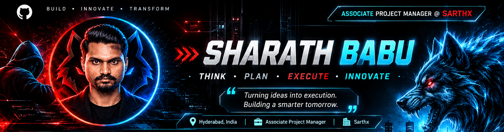

 

---

<table>
<tr>
<td width="58%" valign="top">

<h2>🔹 ABOUT ME</h2>

Hello! I'm **Sharath Babu**, currently working as an **Associate Project Manager at Sarthx**.

I am passionate about technology, strategic planning, project coordination, and building innovative solutions that make an impact.

**My mindset:**

> Think Strategically. Plan Intelligently. Execute Effectively.

</td>
<td width="42%" valign="top">

<h2>🎯 PROFESSIONAL FOCUS</h2>

- 🔹 Project Management
- 🔹 Team Coordination
- 🔹 Strategic Planning
- 🔹 Workflow Management
- 🔹 Communication
- 🔹 Innovation & Technology

</td>
</tr>
</table>

---

<h2 align="center">⚡ TECHNOLOGY INTERESTS</h2>

---

<h2 align="center">📊 GITHUB STATS</h2>

  

---

<h2 align="center">🟢 CONTRIBUTION ACTIVITY</h2>

---

<h2 align="center">🔗 CONNECT WITH ME</h2>

---

### THINK • PLAN • EXECUTE • INNOVATE

**BUILD • INNOVATE • TRANSFORM**

